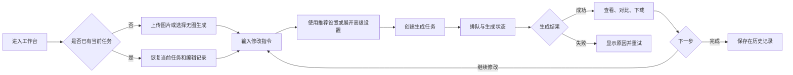

# PicUp UI/UX 改造设计文档

## 1. 文档信息

| 项目 | 内容 |
|---|---|
| 文档名称 | PicUp UI/UX 改造设计文档 |
| 文档状态 | Draft / 待评审 |
| 适用范围 | PicUp Web 用户端 |
| 核心产品 | AI 图片生成与图片编辑工作台 |
| 技术基础 | Next.js 15、React 19、Tailwind CSS、React Query |
| 关联文档 | `PRD.md`、`TECHNICAL_DESIGN.md` |
| 更新时间 | 2026-07-20 |

---

## 2. 改造背景

PicUp 当前已经具备图片上传、自然语言编辑、模型选择、异步任务、结果预览、历史记录、账户、积分充值和支付等核心业务能力。

现有前端采用单页工作台结构，主要功能集中在 `apps/web/src/app/page.tsx`。随着功能增加，创作表单、结果详情、历史记录、账户菜单、支付弹窗和图片查看器都堆叠在同一个页面中，页面结构和状态管理复杂度持续上升。

本次改造不以制作营销首页为目标，而是把 PicUp 建设为一个以图片为中心、支持连续修改、符合桌面端和移动端操作习惯的 AI 图片编辑工具。

---

## 3. 现状问题

### 3.1 信息层级

- 创作、结果和历史在宽屏下同时常驻，历史区域持续占用画布空间。
- 上传区和配置项占据较多首屏面积，图片画布的视觉优先级不足。
- 模型、比例、分辨率与提示词处于同一层级，新用户容易感到配置复杂。
- 生成结果与下一轮编辑之间缺少连续关系，用户需要手动返回编辑区域。

### 3.2 移动端导航

- 当前移动端存在 `create`、`detail`、`history`、`account` 四种状态。
- 底部导航只展示创作、历史和我的，生成后进入 `detail` 时没有对应的导航选中状态。
- 创建和结果被拆成两个视图，不符合移动端连续完成任务的习惯。
- 高级设置与主要编辑输入混排，导致操作区域较长。

### 3.3 历史记录

- 历史卡片缺少搜索、日期分组和状态筛选。
- 每个任务都作为独立记录展示，不利于未来支持多轮编辑会话。
- 宽屏常驻历史栏降低画布利用率。
- 任务恢复依赖页面内状态，刷新后无法稳定恢复当前任务上下文。

### 3.4 账户与支付

- 桌面端和移动端的账户功能不一致。
- 积分充值直接出现在账户下拉菜单中，菜单承担了过多复杂操作。
- 账户编辑、支付、确认框分别实现，缺少统一对话框行为规范。

### 3.5 工程结构

- 首页文件超过 2100 行，页面状态、业务请求和 UI 组件耦合。
- 对话框、抽屉、菜单和图片查看器缺少统一基础组件。
- 当前任务没有稳定映射到 URL，刷新、返回和深链接行为不明确。
- 当前任务模型没有 `conversationId` 或 `parentJobId`，无法表达真正的连续编辑关系。

---

## 4. 改造目标

### 4.1 产品目标

1. 将上传、编辑、生成、查看结果和继续修改整合为一条连续工作流。
2. 提高图片画布在桌面端和平板端的空间占比。
3. 降低首次使用时的配置复杂度，让用户优先描述想要的结果。
4. 统一历史、账户、支付和对话框的交互模式。
5. 保证 360px 手机到 1920px 桌面的完整可用性。
6. 为后续多轮图片编辑、前后对比和局部编辑预留结构。

### 4.2 体验目标

- 用户进入工作台后一次点击即可上传图片。
- 主要生成按钮在所有设备上始终容易触达。
- 生成结果出现后，用户无需离开当前工作台即可继续修改。
- 历史任务可以通过明确入口恢复，并在刷新页面后保留。
- 重要错误显示在发生问题的控件附近，而不是只依赖 Toast。
- 所有弹层具备一致的关闭、返回、焦点和键盘行为。

### 4.3 非目标

- 本次不改造管理后台的信息架构。
- 第一阶段不实现专业图层、选区、蒙版和画笔系统。
- 第一阶段不引入复杂的时间轴或节点式编辑器。
- 第一阶段不强制更换现有模型服务和任务队列架构。

---

## 5. 目标用户与场景

| 用户类型 | 主要任务 | 设计关注点 |
|---|---|---|
| 普通用户 | 换背景、删除物体、添加元素 | 低学习成本、少配置 |
| 自媒体用户 | 修改封面文字、调整风格 | 中文文字效果、快速重复编辑 |
| 电商运营 | 商品图优化、场景替换、多图合成 | 多参考图、高清输出、任务恢复 |
| 轻量设计用户 | 海报修改、构图调整、反复迭代 | 画布空间、前后对比、版本管理 |
| 移动端用户 | 相册上传、快速生成、保存分享 | 单手操作、底部主操作、清晰进度 |

---

## 6. 设计原则

### 6.1 图片优先

图片画布是工作台的视觉中心。辅助信息、历史和账户不能持续挤压画布。

### 6.2 任务连续

创建、结果和继续编辑属于同一任务上下文，不拆成互不关联的页面状态。

### 6.3 渐进式配置

提示词、上传和生成是主流程；模型、比例和分辨率默认由系统推荐，并通过高级设置展开。

### 6.4 状态明确

上传、排队、生成、支付、成功、失败、退款和恢复都应有明确状态，不让用户猜测系统是否正在工作。

### 6.5 平台习惯优先

桌面端使用侧栏、工具栏和快捷键；移动端使用底部导航、底部抽屉和固定主操作。

### 6.6 可恢复

草稿、当前任务、历史任务和支付状态都应具备刷新恢复能力。

---

## 7. 信息架构

### 7.1 一级结构

| 一级模块 | 路由建议 | 说明 |
|---|---|---|
| 工作台 | `/` 或 `/studio` | 默认入口，完成全部图片编辑流程 |
| 历史 | `/history` | 查找、查看、恢复和删除任务 |
| 我的 | `/account` | 资料、积分、订单和账户设置 |
| 登录 | `/login` | 邮箱注册、密码登录、微信扫码 |
| 管理后台 | `/admin` | 保持现有结构，本次仅统一基础视觉令牌 |

### 7.2 工作台内部结构

```text
App Shell
├─ Global Navigation
├─ Workspace
│  ├─ Canvas Toolbar
│  ├─ Canvas Stage
│  ├─ Reference Tray
│  └─ Conversation / Edit Panel
├─ History Drawer
├─ Account Popover
└─ Global Dialog Layer
```

### 7.3 核心流程



---

## 8. 工作台设计

### 8.1 桌面端布局

适用宽度：`>= 1200px`

```text
┌────────┬────────────────────────────────────┬──────────────────┐
│ 导航栏 │            图片画布                │  对话与编辑面板  │
│ 64/220 │                                    │    360-420px     │
│        │  工具栏                            │                  │
│ 新建   │  原图 / 结果 / 对比                │  编辑记录        │
│ 历史   │                                    │  提示词输入      │
│ 我的   │  参考图缩略条                      │  生成设置        │
└────────┴────────────────────────────────────┴──────────────────┘
```

布局规则：

- 导航栏默认 64px，可展开到 220px。
- 编辑面板宽度建议为 380px，可在 360–420px 范围内调整。
- 画布占据全部剩余空间，不设置固定最大宽度。
- 历史记录不作为常驻第三列。
- 工作台占满 `100dvh`，导航、画布和编辑面板分别管理内部滚动。

### 8.2 空工作台

画布中央展示上传入口：

- 支持点击、拖拽和粘贴图片。
- 明确支持的格式和当前模型图片数量上限。
- 提供“无图生成”次级入口。
- 最近使用的编辑类型可显示在输入区上方，但不制作大面积模板卡片。

### 8.3 已上传状态

- 主参考图进入画布。
- 多张参考图进入画布底部缩略条。
- 缩略图支持选择、预览、删除和调整主参考图。
- 图片达到模型上限时禁用继续添加，并在添加按钮附近说明原因。

### 8.4 生成状态

- 画布保留当前参考图，不使用空白加载页替换内容。
- 画布上方显示任务状态条：排队中、生成中、正在处理文字等。
- 对话区新增系统状态消息。
- 生成按钮进入不可重复提交状态，并提供取消入口时再展示取消按钮。
- 轮询失败时显示“连接中断，正在重试”，避免误报任务失败。

### 8.5 结果状态

- 结果直接进入当前画布，不切换到新的移动端导航状态。
- 画布工具栏出现下载、原图对比、适应画布和全屏预览。
- 编辑面板底部输入框文案切换为“继续修改这张图”。
- 用户提交下一轮指令时，默认以上一次结果作为编辑基础。

---

## 9. 对话式编辑设计

### 9.1 对话结构

每轮编辑由以下内容组成：

| 消息类型 | 内容 |
|---|---|
| 用户编辑消息 | 提示词、参考图缩略图、任务类型 |
| 系统状态消息 | 排队、生成中、失败、退款、支付等待 |
| 结果消息 | 结果缩略图、模型、分辨率、耗时、操作按钮 |

### 9.2 输入区

输入区固定在编辑面板底部，包含：

- 添加参考图按钮。
- 多行提示词输入框。
- 快捷编辑类型菜单。
- 高级设置入口。
- 生成按钮。
- 本次预计积分或免费次数提示。

输入区规则：

- `Enter` 提交、`Shift + Enter` 换行仅在桌面端启用。
- 移动端默认通过明确按钮提交，避免输入法误触。
- 上传进行中、支付处理中或请求创建中时禁止重复提交。
- 提示词为空时生成按钮禁用，并提供明确的禁用原因。

### 9.3 自动意图识别

工作台不展示需要用户手动选择的 P 图类型。系统根据自然语言指令自动识别修改文字、更换背景、删除物体、添加元素、商品图优化、海报排版、风格转换和画质增强等意图。

识别结果用于提示词增强和自动模型路由，不增加额外操作步骤。模型控件默认显示“自动”，同时保留菜单供用户指定具体 Provider 和模型。

### 9.4 高级生成设置

高级设置包括：

- 自动推荐或指定模型。
- 图片比例。
- 输出分辨率。
- 预计积分消耗。
- 当前模型参考图上限。

桌面端使用 Popover 或编辑面板内折叠区；移动端使用 Bottom Sheet。

---

## 10. 图片画布与查看器

### 10.1 画布工具栏

推荐工具：

- 适应画布。
- 100% 缩放。
- 放大与缩小。
- 原图 / 结果切换。
- 前后对比。
- 全屏预览。
- 下载。
- 更多操作。

按钮使用 Lucide 图标，未知图标提供 Tooltip，不依赖悬停完成关键任务。

### 10.2 前后对比

桌面端：

- 默认使用拖动分割线。
- 提供“原图 / 结果 / 对比”分段控件。

移动端：

- 默认使用原图和结果标签切换。
- 可选使用长按查看原图。
- 不强制使用难以精确拖动的细小滑杆。

### 10.3 全屏图片查看器

- 支持鼠标滚轮缩放、双击缩放、触摸双指缩放。
- 支持多图左右切换和缩略图导航。
- 显示图片尺寸和当前序号。
- 下载入口在移动端保持一屏可见。
- 关闭后恢复到打开查看器前的焦点位置。

---

## 11. 历史记录设计

### 11.1 入口形式

| 设备 | 默认形式 |
|---|---|
| 桌面端 | 导航打开 400px 左右的历史抽屉，可进入完整页面 |
| 平板端 | 侧边抽屉或完整页面 |
| 移动端 | 底部导航进入独立全屏页面 |

### 11.2 历史页面结构

- 页面标题和任务总数。
- 搜索框。
- 状态筛选：全部、进行中、成功、失败。
- 时间分组：今天、昨天、最近七天、更早。
- 网格 / 列表切换，仅桌面端提供。
- 空状态和搜索无结果状态。

### 11.3 历史卡片

卡片展示：

- 结果缩略图，未完成时使用参考图和状态占位。
- 提示词摘要。
- 任务状态。
- 创建时间。
- 模型与分辨率。
- 继续编辑主操作。
- 查看、下载、删除次级操作。

### 11.4 历史恢复

- 点击任务后进入工作台并设置 `?job=<jobId>`。
- 页面刷新后根据 URL 恢复当前任务。
- 从历史进入的任务明确显示创建时间和任务状态。
- “继续编辑”复制任务配置并以上一次结果作为新输入。
- 返回历史时保留搜索、筛选和滚动位置。

### 11.5 删除行为

- 成功或失败任务使用“删除历史任务”确认框。
- 生成中的任务如果未来支持取消，应分别提供“取消生成”和“删除记录”。
- 删除成功后立即从列表移除，并显示短时 Toast。
- 删除失败时恢复记录并展示行内错误。

---

## 12. “我的”设计

### 12.1 桌面端账户菜单

账户菜单仅保留高频入口：

- 头像、用户名和邮箱。
- 当前积分余额。
- 充值入口。
- 账户设置。
- 管理后台入口，仅管理员可见。
- 退出登录。

充值套餐不直接全部展开在下拉菜单中，点击充值后进入充值对话框或账户页。

### 12.2 完整账户页

账户页包含：

| 区域 | 内容 |
|---|---|
| 账户资料 | 头像、昵称、邮箱 |
| 安全设置 | 修改密码、登录方式 |
| 积分中心 | 当前余额、充值套餐、免费次数 |
| 交易记录 | 充值订单、积分消费、退款 |
| 数据管理 | 历史任务和上传图片管理入口 |
| 法律与帮助 | 用户协议、隐私政策、问题反馈 |
| 会话管理 | 退出当前账户 |

### 12.3 移动端

- “我的”作为底部导航一级页面。
- 资料编辑、积分充值和订单能力与桌面端保持一致。
- 退出登录放在页面底部，避免与高频操作相邻。
- 充值和资料编辑使用完整页面或 Bottom Sheet，不使用狭窄弹窗。

---

## 13. 对话框与抽屉规范

### 13.1 组件类型

| 类型 | 使用场景 | 桌面端 | 移动端 |
|---|---|---|---|
| Confirm Dialog | 删除、清空、退出确认 | 居中弹窗 | 底部确认框 |
| Form Dialog | 简短资料编辑 | 居中弹窗 | Bottom Sheet 或页面 |
| Payment Dialog | 微信支付、订单状态 | 居中弹窗 | 全屏或高位 Bottom Sheet |
| Settings Sheet | 高级生成设置 | Popover / 侧栏 | Bottom Sheet |
| History Drawer | 快速查看历史 | 侧边抽屉 | 独立页面 |
| Image Viewer | 图片预览 | 全屏覆盖 | 全屏覆盖 |

### 13.2 通用行为

- 打开后锁定背景滚动。
- 焦点进入弹层并限制在弹层内部。
- 关闭后恢复触发按钮焦点。
- `Esc` 关闭非强制弹层。
- 移动端系统返回键优先关闭当前弹层。
- 标题、描述和操作按钮顺序保持一致。
- 点击遮罩是否关闭由对话框类型决定。

### 13.3 支付对话框

- 支付等待中不通过误触遮罩关闭。
- 明确展示金额、订单用途、二维码和状态。
- 支付成功后自动关闭并继续原任务。
- 二维码过期时提供刷新入口。
- 关闭支付时保留待提交草稿，返回后可重新发起。

### 13.4 危险确认框

- 使用明确对象名称，例如“删除这条历史任务”。
- 说明删除影响和是否可恢复。
- 取消按钮为默认焦点。
- 危险按钮使用红色，不使用品牌主色。

---

## 14. 响应式规范

### 14.1 断点

| 设备 | 宽度 | 布局策略 |
|---|---:|---|
| 小屏手机 | 360–479px | 单列、底部导航、底部固定输入 |
| 大屏手机 | 480–767px | 单列、扩大图片预览与缩略图 |
| 平板 | 768–1199px | 双区或上下布局、抽屉式历史 |
| 桌面 | 1200–1599px | 导航 + 画布 + 编辑面板 |
| 大桌面 | >=1600px | 扩大画布，编辑面板不超过 420px |

### 14.2 手机端结构

```text
┌──────────────────────┐
│ 顶部栏 / 当前任务状态 │
├──────────────────────┤
│                      │
│      图片画布         │
│      40-55dvh         │
│                      │
├──────────────────────┤
│ 编辑记录 / 参考图      │
├──────────────────────┤
│ 固定提示词输入与生成   │
├──────────────────────┤
│ 创作  历史  我的       │
└──────────────────────┘
```

### 14.3 手机端关键规则

- 点击热区不小于 44px。
- 底部输入区避开 `safe-area-inset-bottom`。
- 输入法弹出时保持提示词输入和提交按钮可见。
- 图片画布初始高度不低于 `40dvh`，结果状态建议为 `45–55dvh`。
- 高级设置不拉长主页面。
- 下载按钮在结果状态下一屏内可触达。

### 14.4 桌面端关键规则

- 不限制工作台为营销站点式最大宽度容器。
- 画布最小宽度建议不低于 520px。
- 编辑面板最小宽度 360px，最大宽度 420px。
- 窗口空间不足时优先收起导航栏，再将高级设置移入抽屉。
- 画布、会话列表和历史抽屉分别滚动，避免整页滚动失控。

---

## 15. 视觉设计系统

### 15.1 视觉方向

整体采用安静、专业、图片优先的创作工具风格。减少装饰性卡片和大面积阴影，依靠清晰层级、间距、边界和操作反馈建立品质感。

### 15.2 颜色建议

| 角色 | 建议颜色 | 用途 |
|---|---|---|
| Canvas | `#F4F6F8` | 应用背景和图片工作区 |
| Surface | `#FFFFFF` | 面板、菜单、对话框 |
| Ink | `#17202A` | 主要文字 |
| Muted | `#667085` | 次要文字 |
| Line | `#D9E0E7` | 边框与分隔线 |
| Brand | `#0F8F83` | 主按钮、选中状态 |
| Brand Hover | `#0A756D` | 主按钮悬停 |
| Credit | `#B7791F` | 积分、支付和费用信息 |
| Success | `#138A5B` | 成功状态 |
| Warning | `#B7791F` | 警告和等待状态 |
| Danger | `#D14343` | 删除和失败状态 |
| Info | `#3578C8` | 信息和连接状态 |

### 15.3 字体

- 使用清晰的中文 UI 字体栈，移除以 Arial 为第一字体的当前配置。
- 正文建议 14–16px。
- 紧凑工具栏使用 13–14px。
- 页面标题建议 20–24px，不在工作台面板中使用超大标题。
- 字间距保持为 0。

### 15.4 圆角与阴影

- 输入框、按钮、卡片统一使用 6–8px 圆角。
- 对话框最大使用 12px 圆角。
- 页面区块不使用悬浮卡片造型。
- 阴影仅用于菜单、抽屉、对话框和浮动工具栏。

### 15.5 动效

- 常规过渡：120–180ms。
- 抽屉和对话框：180–240ms。
- 生成状态使用低干扰进度动画。
- 支持 `prefers-reduced-motion`。
- 不使用会改变布局尺寸的悬停动画。

---

## 16. 状态与反馈

### 16.1 必须覆盖的状态

- 初始空状态。
- 图片上传中、上传成功、部分失败、全部失败。
- 草稿可提交和不可提交。
- 任务创建中。
- 等待支付。
- 排队中。
- 生成中。
- 重试中。
- 生成成功。
- 生成失败。
- 积分退回。
- 网络连接中断和恢复。
- 历史为空、筛选为空和加载失败。

### 16.2 反馈层级

| 反馈方式 | 使用场景 |
|---|---|
| 行内提示 | 表单错误、模型限制、图片数量超限 |
| 状态条 | 当前任务排队、生成和连接状态 |
| Toast | 上传完成、保存成功、删除成功 |
| 对话框 | 删除、清空、支付、关键中断确认 |
| 空状态 | 无任务、无搜索结果、无输出 |

### 16.3 错误恢复

- 上传失败保留已成功上传的图片。
- 任务创建失败保留提示词和全部配置。
- 生成失败提供“使用相同设置重试”和“修改后重试”。
- 支付失败不清空当前编辑草稿。
- 页面刷新后恢复进行中的任务轮询。

---

## 17. 可访问性

- 所有图标按钮提供 `aria-label` 和 Tooltip。
- 表单字段具备可关联的 Label、错误描述和帮助文本。
- 焦点样式满足清晰可见要求。
- 对话框实现焦点锁定和焦点恢复。
- 状态更新使用适当的 `aria-live`，避免频繁打断屏幕阅读器。
- 文字与背景对比度满足 WCAG AA。
- 不能把颜色作为任务状态的唯一识别方式。
- 键盘可以完成上传、填写、设置、生成、查看和下载流程。
- 图片提供与任务语义相符的替代文本。

---

## 18. 路由、状态与数据设计

### 18.1 URL 状态

建议使用以下 URL 表达用户位置：

```text
/?job=<jobId>
/history?status=succeeded&q=<keyword>
/account?section=credits
```

URL 负责：

- 当前任务恢复。
- 历史筛选恢复。
- 浏览器返回与前进。
- 从历史、通知或外部链接进入指定任务。

### 18.2 前端状态边界

| 状态类型 | 建议管理方式 |
|---|---|
| 用户、模型、任务、历史、支付订单 | React Query |
| 当前草稿、上传顺序、提示词、临时设置 | Studio Context + `useReducer` |
| 对话框、抽屉、菜单、查看器 | 局部 UI State |
| 当前任务和历史筛选 | URL Search Params |

第一阶段不要求引入新的全局状态库。

### 18.3 草稿恢复

- 未提交提示词和配置可保存到 `sessionStorage`。
- 用户刷新页面后恢复当前草稿。
- 切换历史任务前，如果当前草稿有修改，提供保留或放弃提示。
- 已上传文件的恢复以服务端文件记录为准，不在浏览器保存原始文件内容。

---

## 19. 前端工程拆分

建议目录：

```text
apps/web/src/
├─ app/
│  ├─ page.tsx
│  ├─ history/page.tsx
│  └─ account/page.tsx
├─ components/
│  ├─ app-shell/
│  │  ├─ app-shell.tsx
│  │  ├─ global-nav.tsx
│  │  └─ mobile-bottom-nav.tsx
│  ├─ studio/
│  │  ├─ studio-workspace.tsx
│  │  ├─ canvas-stage.tsx
│  │  ├─ canvas-toolbar.tsx
│  │  ├─ conversation-panel.tsx
│  │  ├─ prompt-composer.tsx
│  │  ├─ reference-tray.tsx
│  │  └─ generation-settings.tsx
│  ├─ history/
│  │  ├─ history-drawer.tsx
│  │  ├─ history-list.tsx
│  │  ├─ history-card.tsx
│  │  └─ history-filters.tsx
│  ├─ account/
│  │  ├─ account-menu.tsx
│  │  ├─ account-profile.tsx
│  │  └─ credits-panel.tsx
│  ├─ overlays/
│  │  ├─ dialog.tsx
│  │  ├─ bottom-sheet.tsx
│  │  ├─ confirm-dialog.tsx
│  │  ├─ payment-dialog.tsx
│  │  └─ image-viewer.tsx
│  └─ feedback/
│     ├─ task-status.tsx
│     ├─ inline-error.tsx
│     └─ empty-state.tsx
└─ features/studio/
   ├─ studio-context.tsx
   ├─ studio-reducer.ts
   └─ studio-types.ts
```

拆分原则：

- 页面组件负责路由与数据入口。
- Feature 层负责工作台业务状态。
- 展示组件不直接创建 API 请求。
- 对话框和反馈组件形成可复用基础层。
- 保留现有 React Query 请求封装和共享类型。

---

## 20. 后端数据增强

### 20.1 第一阶段

第一阶段可以保持现有任务 API，通过以下方式完成 UI 改造：

- 历史任务加载为新的编辑草稿。
- 当前结果通过已有下载和图片 URL 展示。
- 使用 `jobId` 恢复任务详情。
- 继续编辑时复用现有输入图片和配置。

### 20.2 第二阶段：连续编辑

为支持真正的多轮编辑，建议增加：

```ts
interface ImageJobCreateRequest {
  conversationId?: string;
  parentJobId?: string;
  baseOutputIndex?: number;
}
```

数据层建议：

- 新增 `image_conversations` 表。
- `image_jobs` 增加 `conversation_id`、`parent_job_id` 和轮次字段。
- 输出图片可作为下一轮任务的服务端输入，不要求用户重新上传。
- 历史接口支持按会话聚合和游标分页。
- 删除会话和删除单轮任务使用不同接口语义。

---

## 21. 实施阶段

### 阶段 0：设计确认

预计 1–2 天。

- 确认工作台信息架构。
- 输出桌面、平板、手机低保真线框。
- 确认创建、生成、失败、支付和恢复流程。
- 确认第一阶段是否包含真正的多轮任务模型。

### 阶段 1：设计系统与基础组件

预计 2–3 天。

- 更新颜色、字体、间距、圆角和阴影令牌。
- 建立按钮、输入框、Tooltip、Dialog、Sheet 和状态组件。
- 建立 App Shell 和响应式导航。

### 阶段 2：核心工作台

预计 4–6 天。

- 实现画布优先布局。
- 重构上传与参考图管理。
- 实现对话式编辑面板。
- 实现高级设置折叠和移动端 Bottom Sheet。
- 合并创建和结果状态。

### 阶段 3：历史与账户

预计 3–4 天。

- 新增历史抽屉和完整历史页。
- 增加搜索、筛选和日期分组。
- 重构账户菜单和账户页。
- 统一充值与账户编辑流程。

### 阶段 4：图片查看与响应式

预计 2–3 天。

- 完善全屏图片查看器。
- 实现原图与结果切换。
- 完成平板和移动端适配。
- 验证安全区域和输入法场景。

### 阶段 5：测试与发布

预计 2 天。

- 类型检查与生产构建。
- 关键流程自动化测试。
- 桌面和移动端视觉回归。
- 灰度发布和错误监控。

第一阶段前端总工期预计为 14–20 个工作日。连续会话后端改造预计增加 3–5 个工作日。

---

## 22. 验收标准

### 22.1 功能验收

- 用户可以完成上传、填写、设置、生成、查看、继续编辑和下载。
- 生成结果不再进入无底部导航对应项的移动端状态。
- 历史任务可以搜索、筛选、查看、继续编辑和删除。
- 账户资料、积分和充值能力在桌面端和移动端一致。
- 支付成功后可以自动继续原任务。
- 刷新页面后可以恢复当前任务和进行中状态。

### 22.2 响应式验收

必须验证以下视口：

- `360 x 800`
- `390 x 844`
- `768 x 1024`
- `1024 x 768`
- `1280 x 800`
- `1440 x 900`
- `1920 x 1080`

验收要求：

- 无文本、按钮和图片异常重叠。
- 无非预期水平滚动条。
- 固定区域不遮挡输入、下载和导航操作。
- 画布在桌面端保持主要空间占比。
- 移动端底部操作适配安全区域和输入法。

### 22.3 可访问性验收

- 键盘可以完成主要工作流。
- 所有对话框具备正确焦点行为。
- 图标按钮存在可访问名称。
- 状态和错误不只通过颜色表达。
- 文本对比度满足 WCAG AA。
- 减少动态效果设置能够生效。

### 22.4 工程验收

- 首页不再包含全部业务组件实现。
- 工作台状态、服务端状态和弹层状态边界清晰。
- `pnpm typecheck` 通过。
- `pnpm build` 通过。
- 上传、生成、历史恢复、支付和删除具备测试覆盖。

---

## 23. 风险与处理

| 风险 | 影响 | 处理方式 |
|---|---|---|
| UI 改造与多轮后端同时进行 | 范围扩大、延期 | 分两阶段交付，先完成现有 API 下的体验改造 |
| 画布和编辑面板在平板宽度冲突 | 操作拥挤 | 使用方向感知布局和可折叠编辑面板 |
| 任务状态轮询导致多处状态不一致 | 错误提示重复 | 统一由任务 Query 和状态组件派生 UI |
| 支付关闭后丢失草稿 | 用户需要重新填写 | 支付订单与待提交草稿独立保存 |
| 历史任务数量增长 | 首屏慢、列表卡顿 | 后端游标分页、缩略图和按需加载 |
| 大图导致内存和加载压力 | 移动端卡顿 | 使用缩略图、懒加载和图片尺寸约束 |

---

## 24. 改造优先级

### P0

- 合并创作与结果工作流。
- 画布优先的桌面布局。
- 移动端固定输入和主操作。
- 统一 Dialog、Sheet 和任务状态反馈。
- 拆分当前超大首页组件。

### P1

- 历史搜索、筛选、分组和任务恢复。
- 完整“我的”页面。
- 支付流程统一。
- URL 当前任务状态。
- 图片前后对比。

### P2

- 真正的连续会话数据模型。
- 版本链和多轮任务聚合。
- 局部编辑、蒙版和区域选择。
- 更完整的快捷键和画布工具。

---

## 25. 交付物

- UI/UX 改造设计文档。
- 桌面、平板和手机端线框图。
- 主要页面高保真设计稿。
- 组件状态与交互规范。
- 响应式断点说明。
- 前端组件拆分清单。
- 后端连续会话增强方案。
- 关键流程测试和验收清单。
